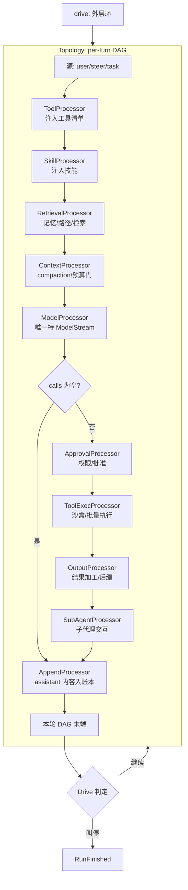

# Topology 化：把 agent loop 重构为「Processor 加工 Turn」的数据流

> 状态：**实验性架构重设计** · 分支 `arch/pipeline-dataflow` · 基线 `master` `8f0cb6bf`
>
> 这条分支在命名、拓扑形状、迁移切片都未定稿前**不合并 master**。本文是设计正本：后续代码必须与本文一致，本文随代码演进。

## 0. 一句话

harness 的一轮工作就是对**一个 `Turn`**做流水线加工：prompt 与 LLM 响应在数据层面是同一种东西（`Message` 账本的延伸），第一次是用户输入拼上文喂给模型，之后每一轮都是把模型输出喂回模型，直到模型叫停。加工逻辑（Processor）不持有数据，数据（Turn）作为加工产物沿 Topology 原地传递——唯一事实源、无复制、无数据竞争。

## 1. 命名决策（先定词，避免后文词不达意）

调研过四个生态的先例，结论是 Kafka Streams 的词汇最贴切：

| 生态 | 节点 | 数据 | 形态 | 为什么不选 |
|---|---|---|---|---|
| Kafka Streams | `Processor` / node | `Record`、`ProcessorContext` | topology 是图，节点单步加工 | **选它** |
| LLVM | `Pass` | `Module`/IR | pass 原地改 IR，唯一事实源 | 「加工」语义弱于 Processor；线性非图 |
| LangGraph | node | `State`（reducer 合并） | `StateGraph` + conditional edge | node 太泛；State 一词 harness 域外含义多 |
| gateway | `Stage` | `RequestCtx` | 线性链 + 三态 outcome | HTTP 请求路由域；同名异形误导 |

**采用**：`Processor`（加工器）+ `Turn`（被加工的数据）+ `Topology`（加工图）。
**弃用**：`Machine`/`Product`/`Factory` 这类自造工厂隐喻——工业界没有先例，徒增理解成本。

LLVM 的「pass 原地改写唯一事实源」思想保留（这正是本设计面向数据的核心），但词汇用 Kafka 的。

### 1.1 命名审计（jev + 2-governance 判据，2026-11-19）

五个核心槽位各出 6 个候选，用 `jev_rerank` 打分（模型 `decision-model-preview`），再用
`2-governance/01-expression.md` 的判据对质。**最终拍板的是维护者，不是分数**——记录在此供未来读者追溯。

| 槽位 | jev 前三名 | 最终采用 | 分歧说明 |
|---|---|---|---|
| 加工器 trait | Worker 0.88 · **Processor 0.86** · Step 0.81 | `Processor` | Worker 高 0.02 属噪声，且在 Rust/daemon 语境强烈暗示后台线程——与「被调度器顺序调用的加工单元」语义冲突 |
| trait 方法名 | **run 0.80** · refine 0.78 · process 0.76 | `process` | **见下方豁免记录**：run 分数更高，维护者选择保留 Kafka 原词 |
| 数据类型 | Frame 0.91 · **Turn 0.88** · TurnState 0.86 | `Turn` | Frame 在流式项目（SSE/ModelStream）已指数据帧；turn 是本领域中心词，配消歧后无冲突 |
| 拓扑 + 驱动 | **Topology+drive 0.98** · Graph+run 0.97 | `Topology` + `drive()` | drive 与 run 语义分层：drive=反复驱动直到叫停（run 级的环） |
| 节点返回枚举 | Decision/Signal/Flow 并列 0.92 · Route 0.90 | `Route` | 全槽平局（±0.02），Route 已在用且 `PolicyDecision` 已占用 Decision 一词 |

**`process` 方法的豁免记录（必读）**：`2-governance/01-expression.md` 把 `apply`/`process`/`handle`
列为函数命名坏信号（「后面要读实现才知道」）。本设计保留 `process` 的理由与补救：

- 理由：Kafka Streams 的 `Processor` 接口方法就叫 `process(Record)`，这是被借词对象的原始契约，
  保持词根一致比换一个「更生动」的词更能让读过 Kafka 的人迁移。维护者认定借词豁免成立。
- 补救（必须兑现，否则豁免无效）：表达力由三处承载——① 方法签名本身
  `process(&self, turn: &mut Turn) -> Route` 让「对谁、结果是什么」可见；② 每个 `Processor` 实现的
  `//!` 模块头说明该节点加工什么；③ 本文 §6 的映射表。若未来出现「不看文档就误解职责」的事故，
  这个豁免应被重新评估。

**`Turn` 与 `turn: u32` 的同名不同义（治理硬判据）**：grep 实锤 12+ 处——
`event.rs:67,69`（TurnStarted/TurnFinished）、`tool.rs:107`（ToolRequest）、`dispatch.rs:32`、
`engine.rs` 六处参数 + `:354`、测试两处。**结论：数据类型保留短名 `Turn`（中心概念配最短名字），
现有 `turn: u32` 轮次序号在一并迁移时全改 `turn_idx`**。本分支尚未写实现，迁移代价为零。

## 2. 两条核心思想

### 2.1 prompt 与 response 是同一条数据带

旧设计把流程看成「prompt 组装 → 模型 → 响应处理」三段，所以有两类不同的扩展点（`prepare_request` 回调 vs 内联的 `dispatch`/`pump_stream`）。这个切法是错的。

真相是：**每一轮都是「账本 + 上文 → 模型 → 账本」**。第一轮的输入是用户 prompt，之后每一轮的输入是上一轮模型的输出（tool 结果、assistant 内容）。数据始终是同一种东西——一个不断增长的 `Message` 账本。因此只有一种加工对象（`Turn`），只有一种加工器接口（`Processor`）。prompt 段的 Processor 往账本前面加内容（工具清单、技能、检索结果），response 段的 Processor 处理模型刚追加的部分——它们操作的是同一个 `Turn`。

这条认知决定了模型形状：不是两条流水线，而是**一张图**，模型调用是图里的一个节点。

### 2.2 面向数据：机器不持有数据，数据是传递的加工产物

每个 Processor 只持有「怎么加工」的策略（配置、句柄、限流器），**不持有任何 per-run 数据**。数据全部在 `Turn` 里，Processor 拿到的是 `&mut Turn`，就地改完交给下一个。

三个随之而来的性质：

1. **唯一事实源**。要改什么就去找 `Turn`。不存在第二份拷贝、不存在「机器 A 的私有状态和机器 B 的不一致」。当前 `LoopDeps` 里散落的 `model`/`tools`/`transcript_sink`/`hooks`，凡是 per-run 的，全部收进 `Turn`；跨 run 的句柄才留在 Processor 里。
2. **无复制**。`Ledger`（可能几十 KB 到 MB 级）在整轮加工中只有一份。旧路径里 `model_turn` 每次 `transcript.to_vec()`（`engine.rs:182`）克隆整个账本发给模型——Topology 化之后这是 Processor 内部的一次性渲染，账本本身从不被复制传递。
3. **数据竞争在编译期消灭**。`&mut Turn` 的单一借用意味着同一时刻只有一个 Processor 能改数据。并发只出现在**单个 Processor 内部**（tool 批量 `join_all` 是 ToolExecProcessor 的事），数据本身的共享可变性为零。想写出竞争都写不出来。

## 3. 类型设计

```rust
// harness-core/src/topology.rs（新模块）

/// 被加工的数据：唯一事实源。沿 Topology 传递，被 Processor 原地改写。
pub struct Turn {
    /// 消息账本。Processor 追加/裁剪它，模型请求由它渲染。
    pub ledger: Vec<Message>,
    /// 本轮已注入的工具清单（ToolProcessor 写，ModelProcessor 读）
    pub tools: Vec<Arc<dyn Tool>>,
    /// 控制：取消令牌 + 转向邮箱（每个 Processor 在边界读）
    pub control: RunControl,
    /// 事件序号（Processor 发事件时自增）
    pub seq: AtomicU64,
    /// 响应段中间产物：模型流泵完后的成形内容
    pub artifacts: TurnArtifacts,
    /// 模型引用（ModelProcessor 建流用，其余 Processor 只读 info）
    pub model: Arc<dyn Model>,
    /// 账本不变式的守卫（见 §5）——切片 5 实现，当前 append/retract 为 todo!()
    safe: LedgerGuard,
}

impl Turn {
    /// 从种子账本起一个 turn；切片 5 补上转录下沉参数
    pub fn new(model: Arc<dyn Model>, control: RunControl, seed: Vec<Message>) -> Self
}
// 以及：Topology::step(&mut turn) -> Route（单遍顺序执行，已实现）
//     Topology::drive(&mut turn) -> RunStopReason（外层环，切片 4）

pub struct TurnArtifacts {
    pub content: Vec<Content>,
    pub calls: Vec<ToolCall>,
    pub results: Vec<ToolResultMessage>,
    pub usage: Usage,
}

/// 加工器：拓扑节点上的加工逻辑。不持有 per-run 数据。
#[async_trait]
pub trait Processor: Send + Sync + 'static {
    fn name(&self) -> &'static str;
    /// 加工一次。返回路由决定。
    async fn process(&self, turn: &mut Turn) -> Route;
}

pub enum Route {
    /// 沿默认出边到下一节点
    Next,
    /// 条件路由：跳到具名节点（图内分支，如「无 tool 调用 → 结束」）
    Goto(&'static str),
    /// 叫停本轮（run 级终止：Completed / Cancelled / Error）
    Done(RunStopReason),
}
```

`Topology` 描述一轮 turn 内的加工顺序（DAG，见 §4）：`step()` 跑单遍（已实现，切片 2 起 prompt 段在上面跑），`drive()` 在外层把 turn 环跑起来（切片 4）。

## 4. Topology 的形状：DAG + 外层环

诚实记录一个约束：Kafka Streams 的 topology 是 **DAG**（流式模型不允许环），而 harness 的「响应 → 再请求 → 直到叫停」是一个真环。处理方式是**分层**：

- **Topology = per-turn DAG**：从源（用户/steer prompt）出发，经 prompt 段 Processor、ModelProcessor、response 段 Processor，到末端。
- **外层 `drive()` 反复进入这张 DAG**：一轮 DAG 跑完 ≠ run 结束。`drive()` 检查 `artifacts` 与 stop 原因，决定下一轮重新进入拓扑还是退出。

环属于 driver，不属于图。这样既拿到图的分支表达力，又不用在图引擎里处理环。



注意 `GATE` 是图内的条件分支（`Route::Goto`），「无 tool 调用 → 直接入账本结束本轮」是一条普通的路由，不是旧代码里 `if tool_calls.is_empty() { return Completed }` 的硬编码短路。

## 5. 三条铁律（决定成败，写进 trait 文档）

**(1) ModelProcessor 是唯一碰 per-token 流的节点。**
`ModelStream` 是逐 token 的（当前 `engine.rs:698-705` 在 `select!` 里逐 event 泵）。如果每个响应 Processor 都 `async` 介入 per-event 循环，`Box::pin` 与虚调用的 token 级开销会拖垮热路径。规则：**只有 ModelProcessor 持 `Pin<&mut ModelStream>` 并逐 event 跑**；其余 Processor 在流泵完、`TurnArtifacts` 成形后才跑，处理的是 `Vec<Content>` 这种 turn 级产物。

**(2) `Turn` 永远是 `&mut` 传递，绝不升级成 `Arc<Mutex<Turn>>`。**
一旦升级，单所有者保证作废，数据竞争回归。（gateway 的 `RequestCtx` 同样是 `&mut` 传递——见 `gateway-pipeline/src/pipeline.rs:98`，这条被验证过。）

**(3) 账本不变式由 `Turn` 的原语守护，不靠 Processor 自觉。**
`Compactor` 有硬规矩：tool-call 与 tool-result 配对不可拆散（`harness-context/src/compactor.rs:42-48`）。旧设计由 loop 强制；Topology 化后调度器不懂业务，必须由 `Turn` 提供 `append_message` / `retract_messages` 原语封装配对逻辑，Processor 调原语而非裸改 `ledger`。

## 6. 旧代码 → Processor 映射

| 现有位置 | 形态 | 迁移后 |
|---|---|---|
| `prepare_request` 单槽回调 (`harness-loop/src/hooks.rs:58`) | 一个 `Arc<dyn Fn>` | ToolProcessor / SkillProcessor / RetrievalProcessor，可注册多个，替代 `compose_prepare_hooks` 手工两两折叠 (`harness-builder/src/assemble.rs:981`) |
| `enforce_budget_gate` (`engine.rs:444`) | 内联 fn + Compactor | ContextProcessor（Compactor 是它的策略） |
| `pump_stream` / `absorb_event` (`engine.rs:678,603`) | 内联 | ModelProcessor（唯一持流） |
| dispatch 六步定序 (`dispatch.rs:68-104`) | 固定顺序 fn | ApprovalProcessor → ToolExecProcessor → OutputProcessor |
| `should_terminate_tool_batch` (`engine.rs:281`) | 回调 | OutputProcessor 的 `Route::Done(Completed)` |
| `PolicyDecision.context_injection`/`output_suffix` (`policy.rs:53-61`) | **死字段**（loop 从不消费，grep 无命中） | ContextProcessor / OutputProcessor 真正消费 |
| `run()` 写死整条流 (`engine.rs:347-428`) | 200 行状态机 | `drive()` + `Topology` 遍历 |
| `LoopHooks` 5 个 Fn 槽 | callback bag | 降格为各 Processor 的实现细节或便捷注册面 |

最好的一件事：`dispatch.rs` 的 `before-hook → before-policy → approval → execute → after-policy → after-hook`（`dispatch.rs:68-104`）本身就是一条教科书式的节点链，只是写死了。拆成 Processor 后，权限/沙盒/子代理各成节点，顺序由拓扑决定。

## 7. 迁移切片（每步独立可 PR、独立可验证）

严格遵守 harness-projects.md 的「PR CI 是主测试路径」：每步一个 PR 到本分支，lint + spec-check + test 三 job 绿了再下一步。

1. **空壳**：引入 `Turn`/`Processor`/`Route`/`Topology`（无实现），`run()` 内部走旧路径，topology 旁路空跑 → 现有 `crates/*/tests` 全绿，零行为变化。
2. **prompt 段**：`prepare_request` 迁成 ToolProcessor（行为等价），删 `compose_prepare_hooks` → prompt 顺序测试绿。
3. **`turn` 消歧**：把现有 `turn: u32` 轮次序号全改 `turn_idx`（§1.1 治理硬判据）——`event.rs`/`tool.rs`/`dispatch.rs`/`engine.rs` 与测试 12+ 处，纯重命名，编译即验收。
4. **ModelProcessor**：`pump_stream`/`absorb_event` 封装，唯一持流；其余响应 Processor 先空实现 → 流式 tool-call 组装测试绿。
5. **response 段**：拆 dispatch 六步为三 Processor，激活 `context_injection`/`output_suffix` 消费 → 权限/沙盒/子代理各自成节点。
6. **开注册面**：builder 增 `Topology::node()` / `with_processor()`，比照 gateway `with_stage_before_forward`（`gateway-facade/src/builder.rs:140`）。

## 8. 已知的开放问题（不定稿，留在这条分支上解决）

- **顺序约束的表达**：ContextProcessor 必须在 ModelProcessor 前——靠拓扑边显式表达，还是靠元数据（如 `kind()`）让调度器检查？倾向前者（边即顺序，可见可测）。
- **ToolExecProcessor 的并行**：`join_all` 在节点内部（`dispatch.rs:321-389` 现状），确认这部分不外泄成图分支。
- **转向（steering）注入点**：当前在 `turn_boundary`（每轮开始）；Topology 化后应是 DAG 源节点的一部分，需确认与 `Route::Goto` 不冲突。
- **预算门的位置**：ContextProcessor 在 prompt 段末，还是 ModelProcessor 自己做？旧代码在 `prepare_request` 之后、模型调用之前（`engine.rs:369`），倾向保持同样的拓扑位置。

## 9. 参考项目佐证

- **Kafka Streams**：`Processor` 是 topology 中「represents a single processing step」的节点（Confluent 文档）——词汇来源。
- **LLVM**：pass 原地改写 IR、PassManager 定序——「机器不持有数据、数据是唯一事实源」的权威先例。
- **LangGraph**：`StateGraph` + 共享 `State` + conditional edge——证明「agent 环用图表达」在 agent 域可行，且 State 单事实源模型成立。
- **dsh-rs**（同 cordis 基底）：`stream_via_waterfall`（`src/llm/runtime.rs:227`）是围绕 `Model::stream` 的有序拦截链——ModelProcessor 的拦截能力可参照。
- **grok-build**：`ExtensionRegistry` 按 `Vec<Arc<dyn Contributor>>` 注册序分发（`registry.rs:68-97`）——Processor 注册表的形态参照。
- **gateway**：`Stage` + `Pipeline` + `&mut RequestCtx`（`pipeline.rs:90-136`）——本设计的形状参照（异形同名，故换词）。
